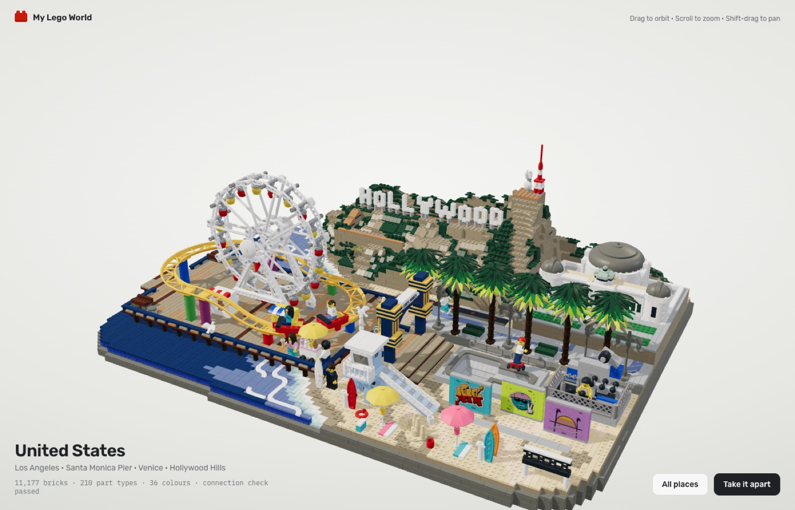

# My Lego World

**Live app → [ericfu-lego-world.pages.dev](https://ericfu-lego-world.pages.dev)**

A LEGO world of the places I have travelled. Spin a brick-built desk globe, tap a country, and its diorama rains down brick by brick onto the globe. Orbit it, zoom into the minifigures, then take it apart into a floating cloud of pieces and watch it rebuild.



Nine places so far, each one a floating island of 3,000–11,000 bricks:

| Place | Bricks | Place | Bricks |
| --- | ---: | --- | ---: |
| Los Angeles | 11,204 | Paris | 6,329 |
| Neuschwanstein | 9,107 | Prague | 5,387 |
| Seoul | 8,667 | Singapore · Marina Bay | 3,423 |
| Shanghai | 8,177 | Kyoto | 3,237 |
| Pattaya | 7,936 | | |

## How it is made

Every brick is a real LEGO part in an official colour. The geometry comes from the [LDraw](https://www.ldraw.org) parts library, and a validator checks that every piece clicks onto a real stud and nothing passes through anything else, so in principle each set could be built for real.

Each country goes through the same pipeline: research the real place and how other builders have built it in LEGO, sign off a plan, build every landmark on its own, assemble the island, then review it against the reference sets until it is done. The app is TypeScript and three.js, built with Vite and hosted on Cloudflare Pages.

The whole thing was designed, built and directed with [Claude](https://claude.com/claude-code). **[How it works](HOW-IT-WORKS.html)** covers the set-building method and the app in more detail.

## Run it locally

```bash
npm install
npm run dev        # http://localhost:5173
npm run gate       # typecheck + build checks + validator for every live set
```

Re-baking parts needs a local copy of the LDraw library: `LDRAW_DIR=<path to ldraw> node tools/ldraw/bake.mjs <part id>`.

## Repository map

| Path | What is in it |
| --- | --- |
| `src/app/` | The app: globe home, set view, entrance and take-apart animations |
| `src/scenes/` | One file per set (`la-island.ts`, `seoul-island.ts`, …) plus each landmark's test scene |
| `src/core/` | Part catalogue, print designs, the builder and brick renderer |
| `src/parts/ldraw/` | Generated geometry for every LDraw part and assembly in use |
| `tools/ldraw/` | Baking LDraw parts and authoring studs-out sub-assemblies |
| `scripts/` | The build gate: validator, stud and assembly checks |
| `docs/country-playbook.md` | The method every country follows |
| `docs/countries/` | Research and build notes for each country |
| `docs/judge/`, `judge/` | Review renders and the scoring rubric |

LEGO® is a trademark of the LEGO Group, which does not sponsor or endorse this project. Part geometry: LDraw.org, CC BY 2.0.
